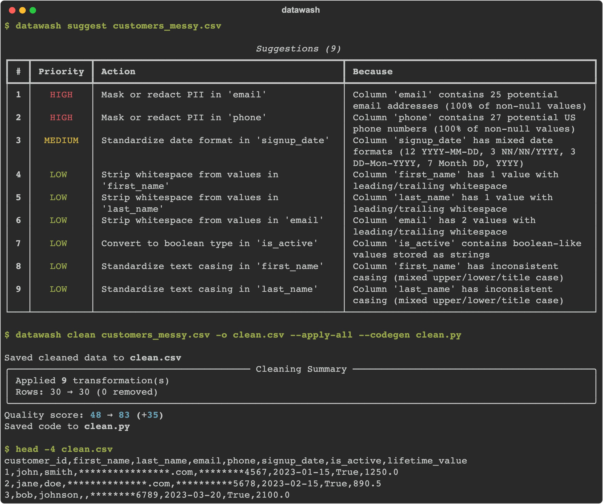

# DataWash

<p align="center">
  <strong>Find the problems in a messy CSV, fix them, and get the pandas code that fixed them.</strong>
</p>

<p align="center">
  <a href="#installation">Installation</a> •
  <a href="#quick-start">Quick Start</a> •
  <a href="#architecture">Architecture</a> •
  <a href="#design-decisions-and-limitations">Limitations</a> •
  <a href="#documentation">Documentation</a>
</p>

<p align="center">
  
  
  
  
  
</p>

---

DataWash is a Python library and CLI for tabular data quality. It profiles a
dataset, finds issues (missing values, mixed date formats, padded or
inconsistently cased text, booleans stored as strings, outliers, duplicate rows
and columns, PII), ranks fix suggestions, applies the ones you pick, and writes
the equivalent pandas code so the cleaning can be reviewed and rerun without
DataWash.

On the bundled `examples/sample_data/customers_messy.csv` (30 rows, 8 columns),
`--apply-all` raises the quality score from 48 to 83, turns four date formats
into ISO dates, converts `yes`/`TRUE`/`0` to booleans and masks emails and
phone numbers. The saved `clean.py` reproduces `clean.csv` exactly.



## Installation

```bash
pip install datawash
```

Optional extras:

```bash
pip install "datawash[formats]"       # Parquet + Excel support
pip install "datawash[ml]>=1.1.0"     # Semantic (embedding-based) duplicate rows
pip install "datawash[dev]"           # pytest, pytest-cov, black, ruff, mypy
```

The ML code ships in version 1.1.0, so `[ml]` needs 1.1.0 or later. To install
this repository's code directly:

```bash
git clone https://github.com/Pranav1011/DataWash.git
cd DataWash
pip install -e .
```

## Quick Start

### Command line

Run these from the repository root:

```bash
# Quality score, column profiles, issues and suggestions
datawash analyze examples/sample_data/customers_messy.csv

# Ranked suggestions with IDs
datawash suggest examples/sample_data/customers_messy.csv

# Apply all (or --apply 1,3,5), save the result and the code that produced it
datawash clean examples/sample_data/customers_messy.csv -o clean.csv --apply-all --codegen clean.py

# Print the pandas code without writing data
datawash codegen examples/sample_data/customers_messy.csv
```

`clean` and `codegen` stop with an error if an `--apply` ID is not in the
suggestion list. IDs depend on `--use-case`, so use the same value for `suggest`
and `clean`.

### Python API

```python
from datawash import analyze

report = analyze("examples/sample_data/customers_messy.csv")  # or a DataFrame

print(f"Quality score: {report.quality_score}/100")   # 48
for s in report.suggestions:
    print(f"[{s.id}] {s.priority.value:<6} {s.action}")

clean_df = report.apply_all()          # or report.apply([1, 3, 5])
print(report.last_score_before, "->", report.last_score_after)  # 48 -> 83
print(report.generate_code())          # defines clean_data(df)
```

Options: `analyze(..., use_case="ml")` re-ranks suggestions,
`sample=False` profiles every row, `parallel=False` runs single-threaded,
`ml_features=True` adds semantic duplicate detection (needs `[ml]`).

## Features

| Detector | What it finds |
|----------|---------------|
| **Missing** | Nulls, empty and whitespace-only strings |
| **Duplicates** | Exact duplicate rows |
| **Formats** | Mixed case, mixed date formats, leading/trailing whitespace |
| **Outliers** | IQR or Z-score outliers in numeric columns |
| **Types** | Numbers and booleans stored as strings |
| **Similarity** | Columns with similar names or values (MinHash + LSH) |
| **PII** | Emails, SSNs, phone numbers, credit cards (Luhn-checked), IPv4, ZIP codes, PII-like column names |
| **Fuzzy duplicates** (opt-in, `[ml]`) | Rows that mean the same thing, via sentence embeddings |

| Transformer | Operations |
|-------------|------------|
| **Missing** | Drop rows, fill with median/mode/value, empty strings to missing, clip outliers |
| **Duplicates** | Drop exact duplicates |
| **Types** | To numeric, boolean, datetime |
| **Formats** | Strip, lower/upper/title case, standardize dates to ISO |
| **Columns** | Drop, rename, merge |
| **Categories** | Normalize categorical values |
| **PII** | Mask, hash, redact, generalize |

Every transformer returns the pandas code for what it did, and
`generate_code(style="function" | "script")` joins them into one file.

## Architecture

Everything runs in one Python process on a pandas DataFrame; there is no
server or database.

```
file / DataFrame
  └─ adapters (CSV, JSON, Parquet, Excel) ──> DataFrame
       └─ dtype optimizer (numeric downcasting)
            └─ SmartSampler: ≥50K rows → ~10K-row sample for analysis
                 ├─ profiler: per-column stats (threads when >5K rows or >20 cols)
                 └─ detectors (7 built-in, +1 with ml_features) ──> Findings
                      └─ suggestion engine ──> ranked Suggestions with IDs
                           (PII dedupe, conflict exclusion, use-case boost)
Report.apply(ids)
  └─ suggestions sorted into execution phases, run on the FULL DataFrame:
     1 duplicates / drop rows → 2 strip + case → 3 fills → 4 type conversion
     → 5 outlier clipping → 6 PII masking → 7 column operations
       └─ each transformer returns (new DataFrame, TransformationResult with code)
            ├─ codegen: concatenates the code into clean_data(df) or a script
            └─ re-analysis of the result ──> score after
CLI (typer + rich): analyze | suggest | clean | codegen, thin wrappers over Report
```

The quality score is `100 − Σ(severity penalty × confidence)` over the findings,
with penalties of 10 (high), 5 (medium) and 2 (low), clamped to 0–100
(`Report._score_findings`).

## Design decisions and limitations

- **In-memory and single process.** The whole file is loaded into pandas;
  files larger than RAM are not supported. Parallelism is a thread pool for
  profiling and detection only.
- **Sampling.** At 50K rows or more, issues are found on a ~10K-row sample, so
  counts in messages are estimates; transformations always run on every row.
  `sample=False` turns this off.
- **The quality score is a heuristic.** It counts findings weighted by severity
  and confidence; it is not validated against human judgments and is not
  comparable across datasets.
- **PII handling.** Detection is regex plus column-name heuristics, so expect
  misses and false positives. Masking keeps the last 4 characters (`****.com`),
  which reduces exposure but is not anonymization; use `hash` or `redact` when
  that matters. Masking runs after other fixes so it masks cleaned values. PII
  columns are never filled from other rows (that would copy one person's email
  onto another), and empty strings in them become missing. Columns that are PII
  only because of a name-like column name (`name`, `first_name`, …) are masked
  only with `--mask-names` / `config={"suggestions": {"mask_names": True}}`.
- **Suggestion IDs are positions in a ranked list.** They change with
  `--use-case` and `--mask-names`, so pass the same flags to `suggest` and
  `clean`.
- **Dates.** Numeric dates like `03/04/2024` are read day- or month-first per
  column from values that can only be read one way; when a column gives no such
  evidence, those values are left unchanged and reported as a warning.
- **Small samples.** Outlier detection uses IQR, so a single extreme value in a
  tiny column (e.g. `age=150` in 5 rows) may not be flagged.
- **Generated code** repeats helper functions for each column and is meant to be
  read and edited, not to be minimal.
- **ML features are optional.** Fuzzy duplicate detection is off by default and
  needs `[ml]` (sentence-transformers). Its 26 tests are skipped without those
  dependencies, which is why the test run reports 26 skipped.

## Performance

Median of three `analyze()` runs on synthetic data from
`tests/validate_performance.py` (seed 42), measured on an Apple M3 Pro
(11 cores), Python 3.12, datawash 1.1.0:

| Dataset | `analyze()` time | Sampled |
|---------|------------------|---------|
| 1M rows x 10 cols | 1.10s | yes |
| 100K rows x 50 cols | 3.65s | yes |
| 10K rows x 100 cols | 7.46s | no |
| 1M rows x 50 cols | 5.72s | yes |
| 50K rows x 250 cols | 17.39s | yes |

Reproduce with `python tests/benchmark_readme.py` (about 2 minutes). Because
large inputs are sampled, time grows with the number of columns much more than
with rows; these are not per-row throughput numbers. `apply()` time is not
included.

## Examples

| Example | Description |
|---------|-------------|
| [`quickstart.py`](https://github.com/Pranav1011/DataWash/blob/main/examples/quickstart.py) | Analyze → suggest → apply → codegen on a small in-memory DataFrame |
| [`csv_cleaning.py`](https://github.com/Pranav1011/DataWash/blob/main/examples/csv_cleaning.py) | Clean `customers_messy.csv` selectively and save CSV + code to `examples/output/` |
| [`ml_preprocessing.py`](https://github.com/Pranav1011/DataWash/blob/main/examples/ml_preprocessing.py) | Compare `general` and `ml` use cases on `employees_messy.csv` |
| [`jupyter_demo.ipynb`](https://github.com/Pranav1011/DataWash/blob/main/examples/jupyter_demo.ipynb) | Notebook walkthrough with charts |

```bash
python examples/quickstart.py
python examples/csv_cleaning.py
python examples/ml_preprocessing.py
```

## Documentation

| Document | Description |
|----------|-------------|
| [Getting Started](https://github.com/Pranav1011/DataWash/blob/main/docs/getting-started.md) | Installation and first steps |
| [User Guide](https://github.com/Pranav1011/DataWash/blob/main/docs/user-guide.md) | Feature walkthrough |
| [API Reference](https://github.com/Pranav1011/DataWash/blob/main/docs/api-reference.md) | Python API |
| [CLI Reference](https://github.com/Pranav1011/DataWash/blob/main/docs/cli-reference.md) | Every command and option |
| [Configuration](https://github.com/Pranav1011/DataWash/blob/main/docs/configuration.md) | Config options |
| [Contributing](https://github.com/Pranav1011/DataWash/blob/main/docs/contributing.md) | How to contribute |

## Use cases and configuration

```python
report = analyze(
    "data.csv",
    use_case="ml",  # "general", "analytics" or "export"
    config={
        "detectors": {
            "outlier_method": "zscore",  # or "iqr"
            "outlier_threshold": 2.5,
            "similarity_name_threshold": 0.8,
        },
        "suggestions": {"max_suggestions": 20, "mask_names": False},
    },
)
```

| Use case | Raises the priority of |
|----------|------------------------|
| `general` | Nothing (severity only) |
| `ml` | Duplicate rows, fuzzy duplicates, missing values, numbers stored as strings, similar columns |
| `analytics` | Missing values, outliers, date formats |
| `export` | Date formats, whitespace, numbers stored as strings |

## Project status

| Metric | Value | Command |
|--------|-------|---------|
| Version | 1.1.0 | `pyproject.toml` |
| Tests | 296 passed, 26 skipped (ML deps not installed) | `pytest` |
| Coverage | 82% of `src/datawash` | `pytest --cov=datawash` on a `[dev]` install |
| Python | 3.10, 3.11, 3.12 | |

Next: advanced imputation (KNN, MICE), cloud storage connectors, schema
validation, and stable suggestion IDs across use cases.

## Requirements

- **Python** >= 3.10
- **Core**: pandas >= 2.0, numpy, pydantic >= 2, rich, typer
- **Optional**: pyarrow and openpyxl (`[formats]`); sentence-transformers,
  faiss-cpu, datasketch, scikit-learn, python-Levenshtein (`[ml]`)

## Development

```bash
git clone https://github.com/Pranav1011/DataWash.git
cd DataWash
pip install -e ".[dev]"

pytest                       # 296 passed, 26 skipped
pytest --cov=datawash        # 82%
black src tests
ruff check src tests
```

## License

MIT License - see [LICENSE](https://github.com/Pranav1011/DataWash/blob/main/LICENSE) for details.

## Acknowledgments

Built with [pandas](https://pandas.pydata.org/), [pydantic](https://docs.pydantic.dev/), [rich](https://rich.readthedocs.io/) and [typer](https://typer.tiangolo.com/).
